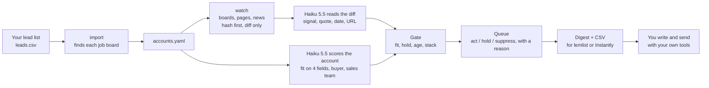

<div align="center">

# signal-engine

### Drop in a list of companies. Every morning it reads what changed on their job boards, sites and news, names the signal, quotes the evidence, and tells you who to contact first. It runs on Claude Haiku 5.5 for cents a day. It never sends anything.


**The twelve checks for qualifying an intent signal, as a script you run before breakfast.**

</div>

---

Your competitors pay for the same intent signals you do. Apollo, HubSpot and Zoom each bought a signal company this year, so when a vendor's alert fires, it fires for everyone on the list. The accounts that reply are the ones where you saw the change first, checked it against your ICP, and opened on the fact itself.

That used to be a job for a person with a spreadsheet, so it got done for fifty accounts a week. signal-engine does it for every account on your list, every day. It fetches each company's job board, four pages of its site and the week's headlines, hashes them, and hands only the changed bytes to Claude Haiku 5.5 with a strict schema and one question: which signal, if any, is this evidence for. The model answers with the signal name, a quote, the date and the URL. Plain code then runs the gate, the age windows, the stack rule and the score, and writes a queue that ends on act, hold or suppress, with a reason and an owner.

```
Code watches. Haiku reads. Code decides. You reach out.
```

## Contents

1. [What you get each morning](#what-you-get-each-morning)
2. [How it works](#how-it-works)
3. [The twelve checks, where each one lives](#the-twelve-checks-where-each-one-lives)
4. [Install and run, step by step](#install-and-run-step-by-step)
5. [Dump your list in](#dump-your-list-in)
6. [What it costs](#what-it-costs)
7. [The files](#the-files)
8. [Command reference](#command-reference)
9. [Configuration](#configuration)
10. [Free vs run by Frontal](#free-vs-run-by-frontal)
11. [Verifying the reader](#verifying-the-reader)
12. [What it does not do](#what-it-does-not-do)
13. [Troubleshooting](#troubleshooting)
14. [Who built this](#who-built-this)

---

## What you get each morning

One markdown digest and one CSV. This is the digest from the first run, on eleven public companies, unedited except for people's names ([full file](examples/first-run-digest.md)):

| Account | Signal | Date | Announced | Conf | Evidence |
|---|---|---|---|---|---|
| lemlist | job_posting | 2026-10-05 | yes | high | Senior Sales / Senior Account Executive - French speaker, location Paris, posted_at 2026-10-05 |
| Linear | job_posting | 2026-10-06 | yes | high | "Account Executive, Enterprise" (Singapore), posted_at 2026-10-06 |
| Cognism | job_posting | 2026-10-01 | yes | high | Added posting: "Sales Director, France", location "Paris", posted_at "2026-10-01" |
| Attio | hiring_campaign | 2026-09-18 | yes | high | Three sales/GTM roles posted within one day: "Forward Deployed GTM Engineer" (posted_at 2026-09-17), "Sales Development Representative" ... |
| ZoomInfo | acquisition | 2026-10-01 | yes | medium | "ZoomInfo Acquires DoubleO.ai to Add AI Orchestration" (published 2026-10-01). Consolidates AI orchestration into ZoomInfo's platform. |

Then the queue, warmest first:

| Score | Account | Buyer | Lead signal | Opener fact |
|---|---|---|---|---|
| 81 | Linear | Head of Sales | job_posting | "Account Executive, Enterprise" (Singapore), posted_at 2026-10-06 |
| 80 | lemlist | Sales Lead | job_posting | Senior Sales / Senior Account Executive - French speaker, Paris, posted 2026-10-05 |
| 77 | Cognism | Chief Revenue Officer | job_posting | "Sales Director, France", Paris, posted 2026-10-01 |
| 68 | Attio | Head of Sales | hiring_campaign | Three sales/GTM roles posted within one day ... |

Six accounts were suppressed on size before any of this, which is the first check doing its job. One was held for having no fresh signal. The whole run cost ten cents at API list price, and nothing at all on a Claude subscription.

Every row above has a URL behind it. Click it and the posting is there. That is the difference between a signal and a score.

## How it works



**Watch.** Three sources, none of which need a key or a browser. Public job boards on Greenhouse, Lever and Ashby return JSON. Four pages of each site (home, about, careers, pricing) are fetched and stripped to text. News comes from a headline feed, seven days back. Everything is hashed. A page that did not change never reaches the model. Reposts and hiring campaigns are computed from posting history in plain code, so the model confirms and quotes instead of guessing.

**Read.** Haiku 5.5 gets one account's diffs and a system prompt that lists every signal name with the evidence it needs. The output is a JSON schema the API enforces: signal, evidence, occurred_on, source_url, announced, confidence. The prompt forbids paraphrasing a date or a headline into something stronger. On the first run it rated an "Account Manager" posting medium on its own, because the title was not on the sales list.

**Score.** Once per account, Haiku answers ten fixed questions from the company's own pages: does it sell to businesses, is there a sales team, how many people, where, who owns pipeline, is there an outbound motion. Fit is pass, fail or unknown on each of the four ICP fields, with the reason quoted. Registry overrides win over estimates.

**Decide.** Fit fail suppresses. Layoffs inside ninety days hold. A signal past its window stops counting. Two signals from different source families make a stack. The score is five components you can read backwards: icp 40, buyer 15, recency 18, relevance 16, second signal 11. Every queue row ends on act, hold or suppress with a `why`.

**Out.** A digest you can read on your phone and a CSV with the buyer title, the lead signal, its date, its URL and the announced fact to open on. Email is blank until you wire in enrichment.

## The twelve checks, where each one lives

These are the checks from my article on qualifying an intent signal before anyone hits send. The engine is that list, in order, as code.

| # | Check | Where |
|---|---|---|
| 1 | Fit. Score the company before you look at the signal. | `config/*.yaml` icp block, four checkable fields. `rank.fit_verdict`. Miss one, suppress. |
| 2 | Person. Name the one person who gets the email. | `score` asks for the most senior pipeline owner on the site; `buyer_titles.by_signal` is the fallback. |
| 3 | Signal. One row per event with its date and a source link. | `data/signals.jsonl`. |
| 4 | Source. Announced or watched. | `announced` on every row. Only announced facts become the opener. |
| 5 | Age. Check it every morning. | `signal_windows_days` per type. The watch layer also drops postings older than 21 days on the day you start. |
| 6 | Match. Who did the tool match a visit to. | No site-visit source yet. See below. |
| 7 | Reach. Verify an email or phone before you score. | Not built. `require_reach: false` until an enrichment step exists. |
| 8 | Score. Pass or fail on fit, intent, recency and reach, then rank warmest first. | `rank.rank_account`. |
| 9 | Who else has it. Assume every competitor saw it the day you did. | Everything here is public. The edge is reading it daily, not owning it. |
| 10 | Timing. Send while the shortlist is forming. | The act condition: an announced signal inside its window on a fit account. |
| 11 | Opener. Lead with the announced fact. | `opener_fact` in every act row. Draft three versions from it, edit one yourself. |
| 12 | Status. Act, hold or suppress, with one owner. | Every queue row. `tuning_hold_days: 30` before you touch the weights. |

## Install and run, step by step

You need Python 3.11+ and [Claude Code](https://code.claude.com) logged in with a Claude subscription. No API key.

```bash
git clone https://github.com/Frontal-so/signal-engine.git signal-engine && cd signal-engine
python3 -m venv .venv && .venv/bin/pip install -r requirements.txt
.venv/bin/python -m pytest -q            # 23 tests, no network, no model
```

Log the Claude Code CLI in once, choosing the subscription option, not the Console one:

```bash
claude /login
```

Then:

```bash
./run.sh import examples/leads.example.csv   # five public companies, boards found automatically
./run.sh snapshot                            # day one: baseline, no model
./run.sh score                               # Haiku answers the ten questions per account
./run.sh rank && ./run.sh digest             # queue + digest, from whatever is fresh
```

Day one has nothing to diff against, so reposts and page changes appear from day two. Fresh postings and this week's headlines show up on day one. From then on:

```bash
./run.sh daily        # snapshot, read, score, rank, digest, export
```

Put that on cron or launchd at 07:00 and read `data/digests/<date>.md` with your coffee.

To bill per token through the API instead, put `ANTHROPIC_API_KEY` in `.env` and set `SIGNAL_ENGINE_BACKEND=api`. Same code, same output.

## Dump your list in

A CSV with two columns is enough:

```csv
company,domain
Attio,attio.com
lemlist,lemlist.com
```

```bash
./run.sh import leads.csv
```

For each company the importer opens the careers page, finds the Greenhouse, Lever or Ashby board behind it, checks that the board answers, and writes the token into `accounts.yaml`. When no board is found it tries the obvious tokens, and if that fails the company is still watched on pages and news, with a note in the output. Optional columns: `size`, `country`, `ats`, `token`, `careers_url`. Re-importing keeps your hand edits.

Everything the engine knows about an account is in `accounts.yaml`, in plain text, so when it is wrong you open the line and fix it.

## What it costs

Haiku 5.5 is $0.10 per million input tokens, $0.50 per million output, and $0.01 per million on cache reads for prompts under 100K tokens. The engine keeps every call under that line and caches the system prompt.

| Scale | Haiku, API list price | On a Claude subscription |
|---|---|---|
| 11 accounts, first run, every source changed | $0.10 for the day | $0 |
| 1,000 accounts, typical day, only changed pages read | about $0.50 | $0 |
| 10,000 accounts, typical day | a few dollars | $0 |

Every call is logged to `data/usage.jsonl` with its token counts and what it would have cost at list price, so the digest can print a real number even when the subscription is paying.

The reason it is this cheap is not the model price alone. Most pages do not change most days, and a hash check is free. Haiku only ever sees a diff.

## The files

Plain text on purpose. When the engine ranks something wrongly, you open the file that caused it and change the line that did it.

```
accounts.yaml              one entry per account: company, domain, board, overrides
config/frontal.yaml        the ICP, buyer titles, signal windows, priors, questions
config/template.yaml       copy this for your own tenant
data/snapshots/<domain>/   dated board, page and news snapshots, plus posting history
data/diffs/<date>.jsonl    what changed today, per account, before the model
data/signals.jsonl         one row per signal: name, evidence, date, URL, announced, confidence
data/features.jsonl        the ten answers per account, with fit verdicts and reasons
data/queue/<date>.jsonl    act / hold / suppress with components and a why
data/digests/<date>.md     the morning read
data/export/<date>-act.csv the act rows, lemlist / Instantly import shape
data/usage.jsonl           every model call, tokens and shadow cost
```

A signal row:

```json
{"date":"2026-10-08","domain":"linear.app","company":"Linear","signal":"job_posting","evidence":"\"Account Executive, Enterprise\" (Singapore), posted_at 2026-10-06","occurred_on":"2026-10-06","source":"https://jobs.ashbyhq.com/linear/6dd5500a-...","announced":true,"confidence":"high","capability":"enterprise sales","model":"claude-haiku-5-5","usd":0.0004}
```

A queue row:

```json
{"status":"act","score":81,"company":"Linear","domain":"linear.app","fit":"pass","lead_signal":"job_posting","stack":["job_posting"],"stacked":false,"buyer":"Head of Sales","icp":40,"buyer_pts":15,"recency":16,"relevance":10,"second":0,"opener_fact":"\"Account Executive, Enterprise\" (Singapore), posted_at 2026-10-06","why":"job_posting 2d old","owner":"sdr"}
```

## Command reference

| Command | What it does | Model |
|---|---|---|
| `run.sh import leads.csv` | add companies, find their boards | none |
| `run.sh snapshot` | fetch boards, pages, news; hash; write today's diffs | none |
| `run.sh read` | turn today's diffs into signals | Haiku 5.5 |
| `run.sh score [--force]` | answer the ten questions per account; skips accounts scored in the last 30 days | Haiku 5.5 |
| `run.sh rank` | gate, score, status; writes today's queue | none |
| `run.sh digest` | today's markdown | none |
| `run.sh export` | today's act rows as CSV | none |
| `run.sh daily` | all of the above, in order | Haiku 5.5 |

Flags: `--tenant <name>` picks `config/<name>.yaml`; `--accounts <file>` picks a registry; `--model claude-sonnet-5-5` swaps the reader; `--day YYYY-MM-DD` reruns a past day.

## Configuration

`config/frontal.yaml` is the live example. The blocks you will edit:

- **icp**: four fields, each one checkable on a website. Industry, size range, regions, must-have.
- **buyer_titles**: the default list and an override per signal type. After a raise the buyer is the VP Sales or the CRO, because the board just raised their pipeline number.
- **signal_windows_days**: how long each signal type stays warm. Retire a type once its replies fall back to your baseline.
- **signal_priors**: relevance points per type, 0 to 16. What a signal is worth to your offer.
- **sales_role_keywords**: which job titles count as sales capability being added.
- **judgment_questions**: the ten questions Haiku answers per account. Add one and it appears in `features.jsonl`.
- **scoring**: the five components. Keep them readable; a single total cannot be read backwards.

## Free vs run by Frontal

The engine is the qualification layer. It is free, it runs on your subscription, and it is the whole method. What it does not do is the work around it.

| | This repo | Run by Frontal |
|---|---|---|
| Watch a list, read diffs, name signals with evidence | yes | yes |
| Fit gate, age windows, stack rule, ranked queue | yes | yes |
| Building the list in the first place | your CSV | built from your ICP |
| Finding the person and a verified email or phone | blank column | enrichment waterfall |
| Writing from the opener fact | you, with your own tools | three drafts per account, one edited by a person |
| Sending, replies, and the thirty-day tuning loop | you | run and reported by signal type |

If you want the queue filled and worked, that is what we do at [Frontal](https://frontal.so).

## Verifying the reader

The first-run signals above look right to me. That is not a measurement. `evals/agreement.py` runs Haiku 5.5 and Sonnet 5.5 against diffs you have labeled by hand and prints exact match, precision and recall per model, with the cost:

```bash
cp evals/labeled.example.jsonl evals/labeled.jsonl   # then add 100 to 200 real diffs
.venv/bin/python evals/agreement.py evals/labeled.jsonl
```

Label a hundred before you trust the reader on your own list. If Haiku lands within a couple of points of Sonnet, it stays. If it does not, `--model claude-sonnet-5-5` on the read step costs twenty times more and is still cheap.

## What it does not do

- **Find accounts.** You bring the list.
- **Find people or emails.** The buyer title comes from the company's pages. Check 7 is yours to wire in.
- **Watch LinkedIn.** Posts and engagement are a fourth source waiting on a reliable fetch path.
- **Send.** Export only. A lemlist or Instantly push is one adapter away once the act list has earned it.
- **Replace judgment on copy.** The opener fact is a fact. The email is yours.

## Troubleshooting

| Symptom | Cause | Fix |
|---|---|---|
| `claude -p error: OAuth session expired` | the CLI is not logged in | `claude /login`, pick the subscription option |
| the usage log shows `claude-haiku-4-5` | an alias resolved to the older model | the engine passes the full id `claude-haiku-5-5`; check `--model` |
| every page shows `first_seen` and nothing fires | day one | run again tomorrow; fresh postings and headlines still fire on day one |
| `size: unknown` holds an account | the pages do not say | add `size:` to the account in `accounts.yaml` |
| `no public board found` on import | careers page is not on Greenhouse, Lever or Ashby | add `careers_url`, or leave it; pages and news are still watched |
| a 404 under Source health | a guessed page path | set `pages:` on the account to the real URLs |

## Who built this

I am Alex Vacca, founder and CEO of [Frontal](https://frontal.so), where we build AI-native revenue systems for B2B companies that want pipeline without adding headcount. This engine is the signal-qualification method we run, written down as code so you can run it on your own list for nothing.

Contributions welcome: a fourth source, an enrichment adapter, labeled diffs for the eval. Open an issue or a PR.

MIT. Watch responsibly: everything it reads is public, and it never contacts anyone.
